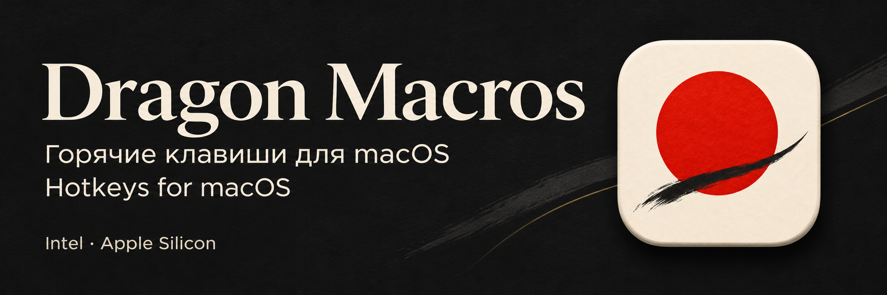
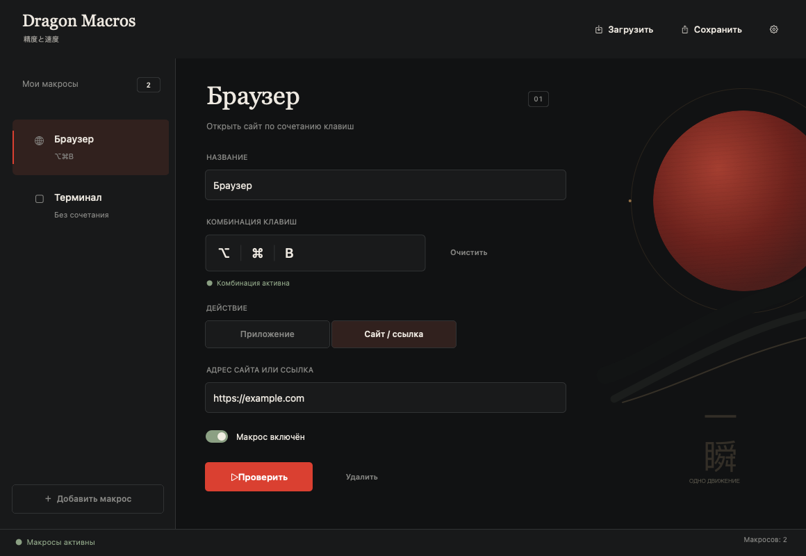
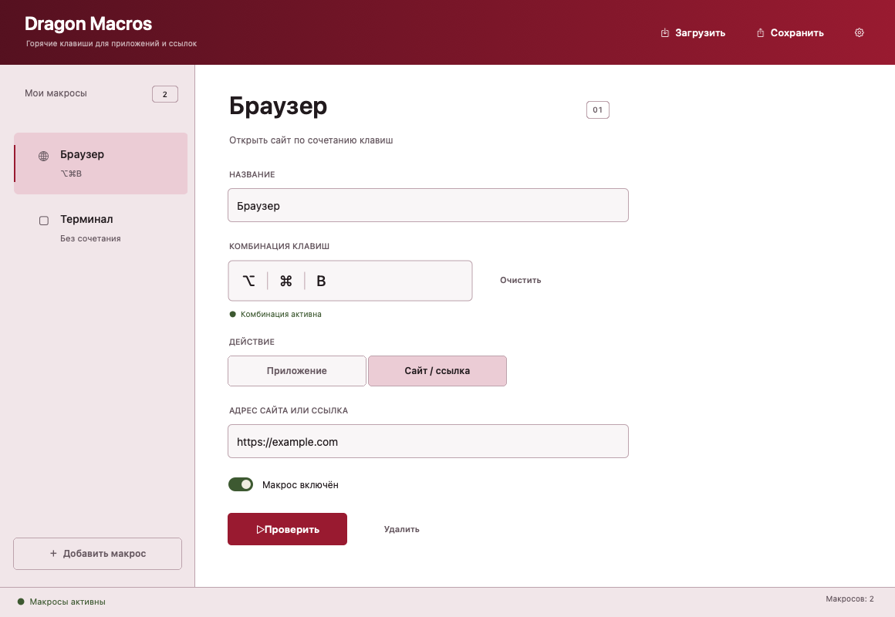
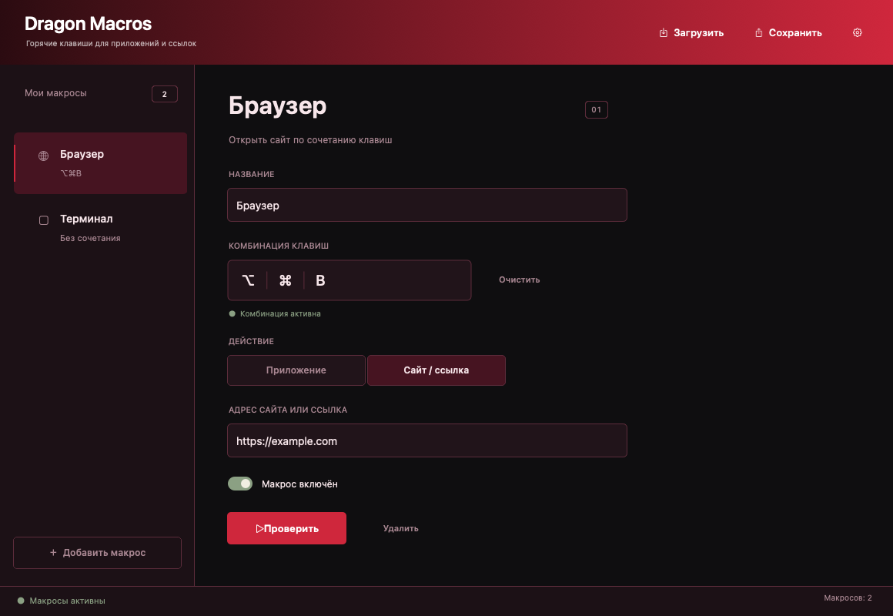
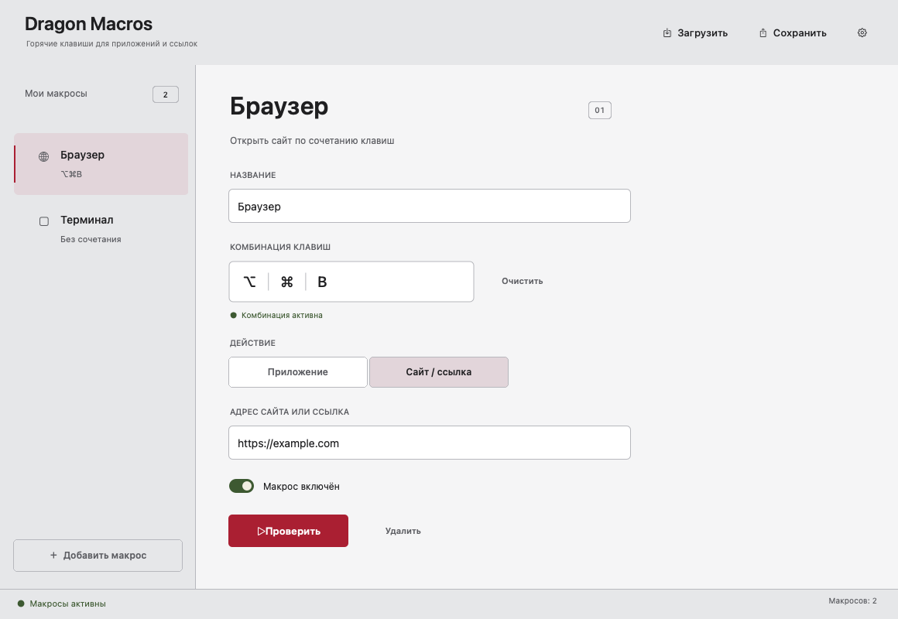
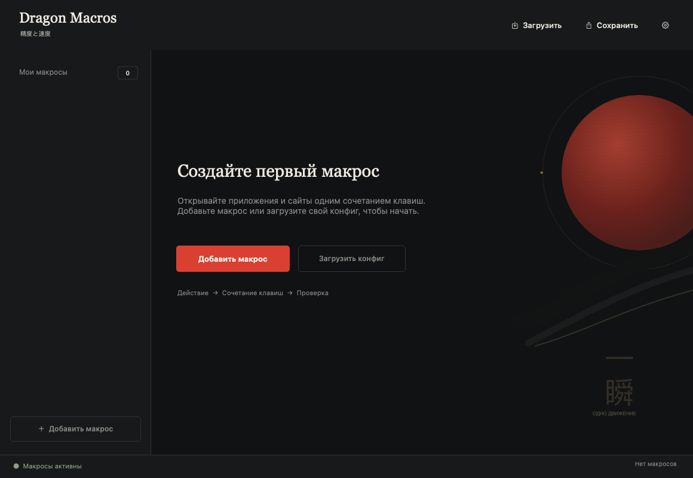

<p align="center"><a href="README.md">Русский</a> · <a href="README.en.md">English</a></p>

<p align="center"></p>

<p align="center">
  <a href="https://github.com/Slipcast-dev/DragonMacros/stargazers"></a>
  <a href="https://github.com/Slipcast-dev/DragonMacros/releases"></a>
  <a href="https://github.com/Slipcast-dev/DragonMacros/releases/latest"></a>
  <a href="https://github.com/Slipcast-dev/DragonMacros/actions/workflows/ci.yml"></a>
  <a href="LICENSE"></a>
  
</p>

# Dragon Macros

Global hotkeys for apps and links on your Mac. Assign a shortcut, choose an action,
and trigger it from any application. Native AppKit interface, Japanese-inspired
Samurai Motion styling, and Russian and English localization.

**macOS 11+ · Intel and Apple Silicon · no third-party Swift dependencies.**

## Download 1.0

[**DMG — drag to Applications**](https://github.com/Slipcast-dev/DragonMacros/releases/download/v1.0/DragonMacros-1.0-macOS.dmg)
· [PKG installer](https://github.com/Slipcast-dev/DragonMacros/releases/download/v1.0/DragonMacros-1.0-macOS.pkg)
· [SHA256 checksums](https://github.com/Slipcast-dev/DragonMacros/releases/download/v1.0/SHA256SUMS.txt)
· [All releases](https://github.com/Slipcast-dev/DragonMacros/releases)

Both installers include a universal application for Intel and Apple Silicon.
Fully quit the previous instance with **⌘Q** before updating. Existing macros and
preferences are retained. The app is ad-hoc signed and **not notarized**. If Gatekeeper
shows a warning, use the system security settings to open it only after verifying
the source. Do not disable Gatekeeper globally.

The stars and downloads badges update automatically. Downloads count GitHub release
asset downloads, not unique users or installations.

## Features

- Global shortcuts through Carbon `RegisterEventHotKey`, without Input Monitoring or Accessibility permission.
- Launch an installed `.app` or open a website / link; record a shortcut and see registration conflicts.
- Safe links: websites and mail open directly, local files and scripts are blocked, other schemes (`smb:`, `ssh:`, app schemes) open only after confirmation.
- Load and save JSON configurations with **⌘O / ⌘S**; loading first lists the actions inside, then replaces or appends macros.
- Four styles: **Samurai**, original white and red, black and red, and system. Motion respects macOS Reduce Motion and can be disabled in settings.
- Russian and English UI, switchable while the app is running.
- Pause macros (kept across restarts), use a menu bar icon, show the app in the Dock, launch at login (macOS Login Items on 13+), or start minimized.
- Local storage without telemetry. The app does not transmit data; selected links are handed to system URL handlers.

## Interface



<details>
<summary>Other styles and first launch</summary>









</details>

Screenshots come from isolated AppKit checks using temporary sample data; the UI
shown is Russian. The app also provides English labels. On first launch, choose
**Add macro** or **Load config**. Select **Samurai** in settings (**⌘,**) for the animated composition.

## Data and reliability

Macros: `~/Library/Application Support/DragonMacros/macros.json`. Preferences use
`UserDefaults`. Exported configurations are separate JSON files saved wherever you choose.
Import is limited to **500 macros and 2 MB**; exceeding either limit rejects the entire operation.

Text saves automatically 0.4 seconds after input. Pending edits are saved immediately
before changing macros, closing a window, exporting, or quitting. Write errors are
shown to the user. Damaged data is copied to a unique `macros.corrupt-<UUID>.json`
backup (files over 2 MB are moved as a whole); failed backup creation blocks further writes. See the [security policy](SECURITY.en.md)
for details and protection boundaries.

## Build from source

Requires **macOS, Python 3, and Apple Command Line Tools** (`xcode-select --install`).
Full Xcode and third-party Swift packages are not required.

```sh
git clone https://github.com/Slipcast-dev/DragonMacros.git
cd DragonMacros
git config core.hooksPath .githooks
./build.sh universal test-app dmg pkg
```

| Output | Location |
|---|---|
| Application | `.build/DragonMacros.app` |
| Test copy | `DragonMacros-Test.app` in the project root |
| Installers and checksums | `dist/` |

`./build.sh` builds for the current Mac only. The optional `install` flag copies the
app to `~/Applications`. The test copy uses **the same user macros and preferences**
as the regular app; it is not an isolated data profile. Only one instance runs at a time.

For a Developer ID release, set `SIGN_IDENTITY` (app and dmg signing),
`PKG_SIGN_IDENTITY` (pkg signing) and `NOTARY_PROFILE` (an `xcrun notarytool`
keychain profile for notarization). Without them the build uses ad-hoc signing.

## Checks

```sh
./test.sh
python3 -m unittest discover -s Icon -p 'test_*.py'
./test-interface.sh
```

Tests use temporary data. The AppKit check creates offscreen screenshots in
`.build/interface-tests/` and checks fields, pending text persistence, counters,
the empty state, styles, and Core Animation contracts. It does not replace checking
global shortcuts, system dialogs, or animation playback in a real window.
The Swift module cache stays in `.build/`.

## Development and support

- [Contributing](CONTRIBUTING.en.md) · [Code of conduct](CODE_OF_CONDUCT.en.md).
- [Changelog](CHANGELOG.en.md) · [1.0 release notes](docs/RELEASE-v1.0.md#english).
- [Report a bug](https://github.com/Slipcast-dev/DragonMacros/issues/new/choose).
- Vulnerabilities: [SECURITY.en.md](SECURITY.en.md). Do not post sensitive details in public issues.
- Engineering notes: [architecture and checks](docs/PROJECT_REVIEW.md) (Russian), [design](docs/DESIGN.en.md).

Code and documentation are [MIT licensed](LICENSE). Artwork sources and distribution
terms: [artwork notice](NOTICE.en.md), [artwork sources](docs/ARTWORK.en.md).
