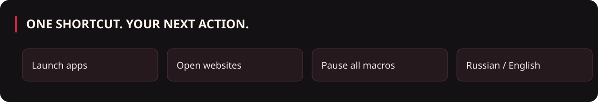
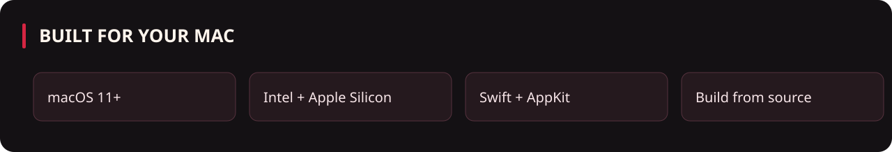
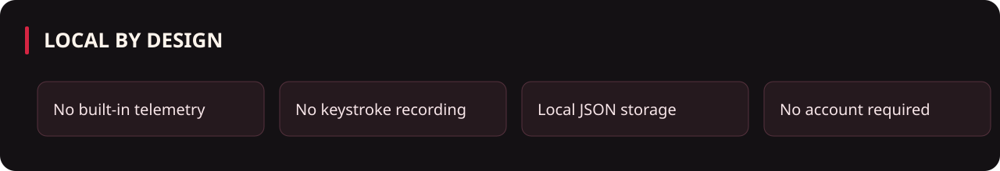

<p align="center"></p>

<p align="center">
  
  
  
  
</p>

<p align="center">
  <a href="https://github.com/Slipcast-dev/DragonMacros/actions/workflows/ci.yml"></a>
  <a href="LICENSE"></a>
</p>

# Dragon Macros

Приложение для macOS: назначьте глобальную комбинацию клавиш и выберите действие — **открыть приложение** из списка
установленных или **открыть сайт / ссылку**. Работает с любой клавиатурой, не требует разрешений «Мониторинг ввода»
и «Универсальный доступ» (комбинации регистрируются через Carbon `RegisterEventHotKey`).

*Hotkeys that open apps and websites on your Mac. Any keyboard, no special permissions. Interface in Russian and English.*



## Возможности

- Макросы на комбинации клавиш: запись комбинации кликом, проверка конфликтов и занятых системой сочетаний.
- Действия: открыть приложение (список из `/Applications`, `/System/Applications`, `~/Applications`, есть «Другое приложение…») или открыть ссылку (`https://`, `mailto:` и др.; схема `https://` добавляется сама).
- Настройки (кнопка в шапке или ⌘,): значок в Dock, значок «M» в строке меню, запуск при входе в систему, запуск в свёрнутом виде.
- Стили: оригинальный бело-красный, чёрно-красный, «как в системе».
- Язык интерфейса: русский / English, переключается на лету.
- Пауза всех макросов из меню в строке меню.

Макросы хранятся в `~/Library/Application Support/DragonMacros/macros.json`.

## Установка

Соберите приложение из исходников по инструкции ниже. Команда `./build.sh universal dmg`
создаст локальный установщик `dist/DragonMacros-0.2-macOS.dmg`; перетащите приложение в «Программы».
Готовые бинарные релизы в репозитории пока не опубликованы.

Сборка подписана ad-hoc и не нотаризована. При предупреждении Gatekeeper используйте
«Системные настройки → Конфиденциальность и безопасность → Всё равно открыть» только
для своей сборки или проверенного источника. Не отключайте Gatekeeper целиком.



## Сборка

Нужны macOS, Python 3 и Apple Command Line Tools (`xcode-select --install`), полный Xcode не требуется.

```sh
git clone https://github.com/Slipcast-dev/DragonMacros.git
cd DragonMacros
git config core.hooksPath .githooks
```

```sh
./build.sh                       # сборка для этого Mac → .build/DragonMacros.app
./build.sh universal install dmg # Intel + Apple Silicon, копия в ~/Applications и dist/*.dmg
```

## Структура

| Путь | Назначение |
|---|---|
| `Sources/main.swift` | всё приложение (AppKit + Carbon) |
| `build.sh` | сборка `.app`, иконки, ad-hoc подпись, установка, `.dmg` |
| `Icon/` | `make_icons.py` (иконки), `prepare_logo.py` (ресурсы из логотипа, нужен Pillow), `make_banner.py` (баннер) |
| `Icon/source/` | исходный логотип и подготовленные ресурсы |
| `docs/images/hero.png` | баннер проекта |
| `.githooks/` | хук pre-commit против утечки секретов |



## Безопасность

Подробности — в [SECURITY.md](SECURITY.md). Кратко: сеть не используется, ввод не перехватывается, ссылки со схемами `file:`/`javascript:`/`data:` блокируются, запускаются только `.app`, данные хранятся с правами 0600. `.gitignore` и локальный хук `.githooks/pre-commit` помогают предотвратить случайные утечки;
они не заменяют серверную защиту ветки. Приложение не работает в App Sandbox.
Сторонние URL-схемы могут вызывать системные обработчики — добавляйте только доверенные ссылки.

## Разработка и поддержка

- [Участие в проекте](CONTRIBUTING.md) и [правила сообщества](CODE_OF_CONDUCT.md).
- [История изменений](CHANGELOG.md), [анализ проекта](docs/PROJECT_REVIEW.md).
- [Сообщить об ошибке](https://github.com/Slipcast-dev/DragonMacros/issues/new/choose).
- Уязвимости: см. [SECURITY.md](SECURITY.md); не публикуйте детали в issues.

## Лицензия

Код — [MIT](LICENSE). Графика и её происхождение описаны в [NOTICE.md](NOTICE.md) и [docs/ARTWORK.md](docs/ARTWORK.md).
