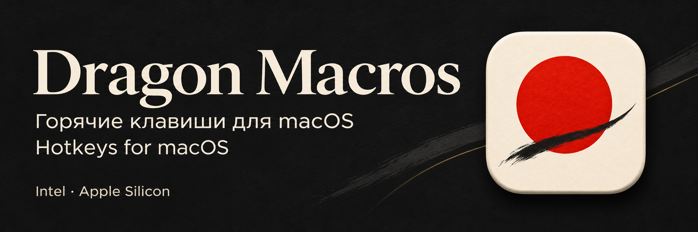
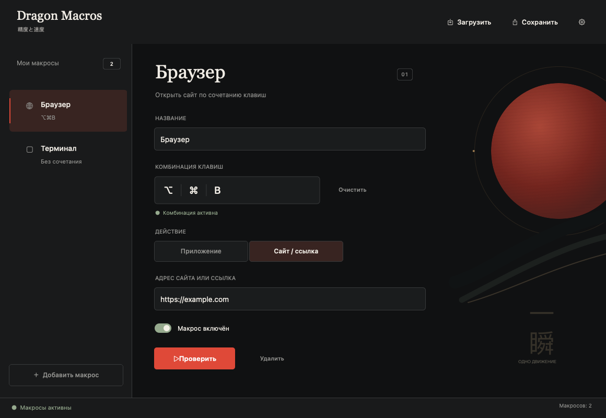
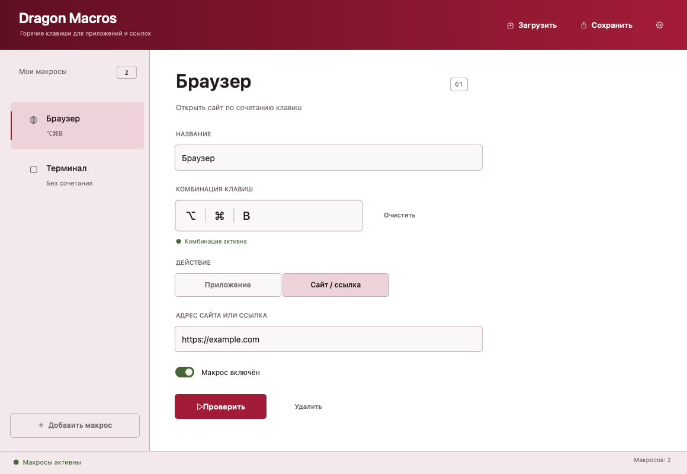
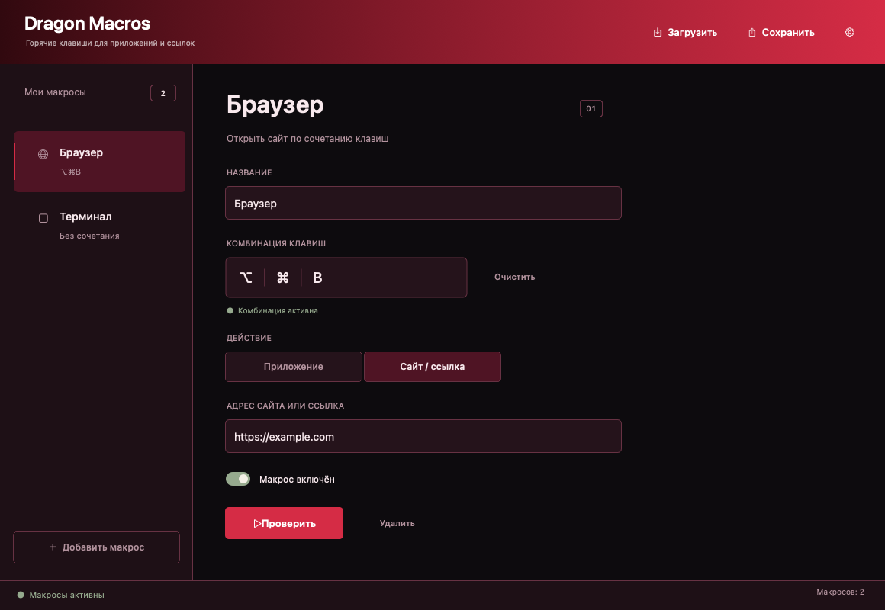
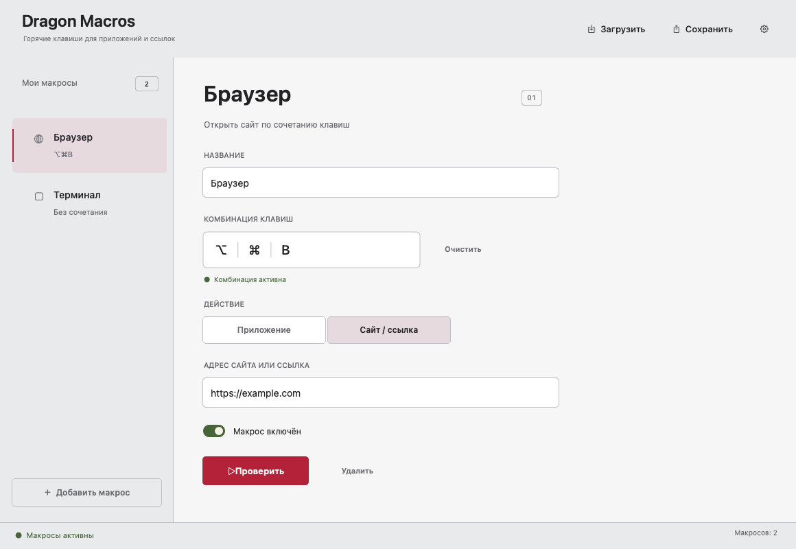
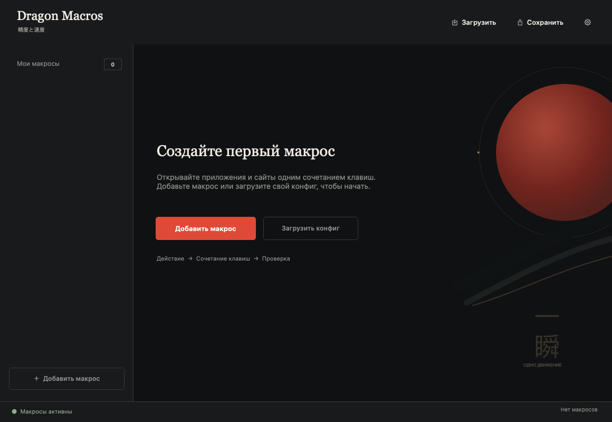

<p align="center"><a href="README.md">Русский</a> · <a href="README.en.md">English</a></p>

<p align="center"></p>

<p align="center">
  <a href="https://github.com/Slipcast-dev/DragonMacros/stargazers"></a>
  <a href="https://github.com/Slipcast-dev/DragonMacros/releases"></a>
  <a href="https://github.com/Slipcast-dev/DragonMacros/releases/latest"></a>
  <a href="https://github.com/Slipcast-dev/DragonMacros/actions/workflows/ci.yml"></a>
  <a href="LICENSE"></a>
  
</p>

# Dragon Macros

Глобальные горячие клавиши для приложений и ссылок на Mac. Назначьте сочетание,
выберите действие и запускайте его из любого приложения. Нативный интерфейс AppKit,
японское оформление Samurai Motion, русский и английский языки.

**macOS 11+ · Intel и Apple Silicon · без сторонних Swift-зависимостей.**

## Скачать 0.5.1

[**DMG — перетащить в «Программы»**](https://github.com/Slipcast-dev/DragonMacros/releases/download/v0.5.1/DragonMacros-0.5.1-macOS.dmg)
· [PKG — установщик](https://github.com/Slipcast-dev/DragonMacros/releases/download/v0.5.1/DragonMacros-0.5.1-macOS.pkg)
· [SHA256](https://github.com/Slipcast-dev/DragonMacros/releases/download/v0.5.1/SHA256SUMS.txt)
· [Все релизы](https://github.com/Slipcast-dev/DragonMacros/releases)

Оба установщика содержат универсальное приложение для Intel и Apple Silicon.
Перед обновлением полностью завершите старый экземпляр через **⌘Q**.
Макросы и настройки сохраняются. Сборка подписана ad-hoc и **не нотаризована**;
при предупреждении Gatekeeper открывайте её через системные настройки безопасности
только после проверки источника. Не отключайте Gatekeeper целиком.

Значки звёзд и скачиваний обновляются автоматически. Скачивания — это загрузки
файлов релизов GitHub, а не число уникальных пользователей или установок.

## Возможности

- Глобальные сочетания через Carbon `RegisterEventHotKey`, без разрешений «Мониторинг ввода» и «Универсальный доступ».
- Запуск установленного `.app` или открытие сайта / ссылки; запись сочетания и отображение конфликтов.
- Загрузка и сохранение JSON-конфига через **⌘O / ⌘S**, с заменой или добавлением макросов.
- Четыре стиля: **Самурай**, бело-красный, чёрно-красный и системный. Анимация учитывает «Уменьшение движения» macOS и отключается в настройках.
- Русский и английский интерфейсы, переключаемые на лету.
- Пауза макросов, значок строки меню, отображение в Dock, запуск при входе и запуск в свёрнутом виде.
- Локальное хранение без телеметрии. Приложение не отправляет данные; выбранные ссылки передаются системным обработчикам.

## Интерфейс



<details>
<summary>Другие темы и первый запуск</summary>









</details>

Снимки получены из изолированной AppKit-проверки с временными демонстрационными данными.
При первом запуске нажмите **«Добавить макрос»** или **«Загрузить конфиг»**.
Для анимированной композиции выберите стиль **«Самурай»** в настройках (**⌘,**).

## Данные и надёжность

Макросы: `~/Library/Application Support/DragonMacros/macros.json`. Настройки хранятся
в `UserDefaults`. Конфиг для переноса — отдельный JSON в выбранной вами папке.
Импорт ограничен **500 макросами и 2 МБ**; превышение лимитов отклоняет операцию целиком.

Текст автоматически сохраняется через 0,4 секунды после ввода; перед сменой макроса,
закрытием окна, экспортом и выходом изменения записываются сразу. Ошибки записи
показываются пользователю. Повреждённый файл копируется под уникальным именем
`macros.corrupt-<UUID>.json`; при неудачном резервировании дальнейшая запись блокируется.
Подробности и ограничения — в [политике безопасности](SECURITY.md).

## Сборка из исходников

Нужны **macOS, Python 3 и Apple Command Line Tools** (`xcode-select --install`).
Полный Xcode и сторонние Swift-пакеты не требуются.

```sh
git clone https://github.com/Slipcast-dev/DragonMacros.git
cd DragonMacros
git config core.hooksPath .githooks
./build.sh universal test-app dmg pkg
```

| Результат | Путь |
|---|---|
| Приложение | `.build/DragonMacros.app` |
| Тестовая копия | `DragonMacros-Test.app` в корне проекта |
| Установщики и контрольные суммы | `dist/` |

`./build.sh` собирает только для этого Mac. Флаг `install` отдельно копирует приложение
в `~/Applications`. Тестовая копия использует **те же пользовательские макросы и настройки**,
что и обычная сборка; отдельного профиля данных у неё нет. Одновременно работает один экземпляр.

Для релиза с Developer ID задайте `SIGN_IDENTITY` (подпись приложения и dmg),
`PKG_SIGN_IDENTITY` (подпись pkg) и `NOTARY_PROFILE` (профиль `xcrun notarytool`
для нотаризации). Без этих переменных используется ad-hoc подпись.

## Проверки

```sh
./test.sh
python3 -m unittest discover -s Icon -p 'test_*.py'
./test-interface.sh
```

Тесты используют временные данные. AppKit-проверка создаёт offscreen-снимки в
`.build/interface-tests/`, проверяет поля, сохранение текста, счётчики, пустое состояние,
темы и контракты Core Animation. Она не заменяет проверку горячих клавиш, системных
диалогов и воспроизведения анимации в реальном окне. Кэш Swift хранится в `.build/`.

## Разработка и поддержка

- [Участие в проекте](CONTRIBUTING.md) · [Правила сообщества](CODE_OF_CONDUCT.md).
- [История изменений](CHANGELOG.md) · [Заметки к 0.5.1](docs/RELEASE-v0.5.1.md).
- [Сообщить об ошибке](https://github.com/Slipcast-dev/DragonMacros/issues/new/choose).
- Уязвимости: [SECURITY.md](SECURITY.md). Не публикуйте чувствительные детали в issues.
- Инженерные материалы: [архитектура и проверки](docs/PROJECT_REVIEW.md), [дизайн](docs/DESIGN.md).

Код и документация — [MIT](LICENSE). Источники и условия распространения графики:
[NOTICE.md](NOTICE.md), [ARTWORK.md](docs/ARTWORK.md).
